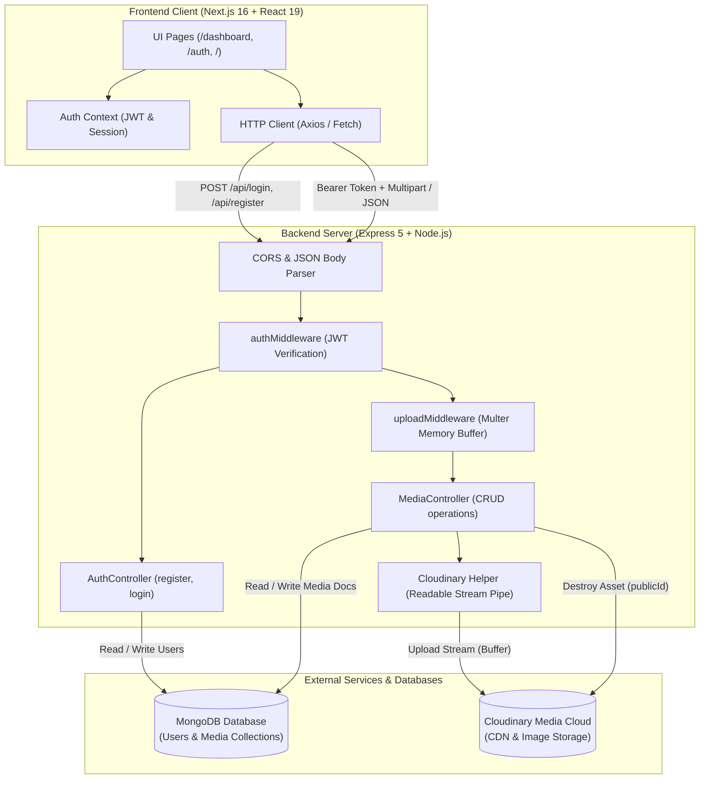
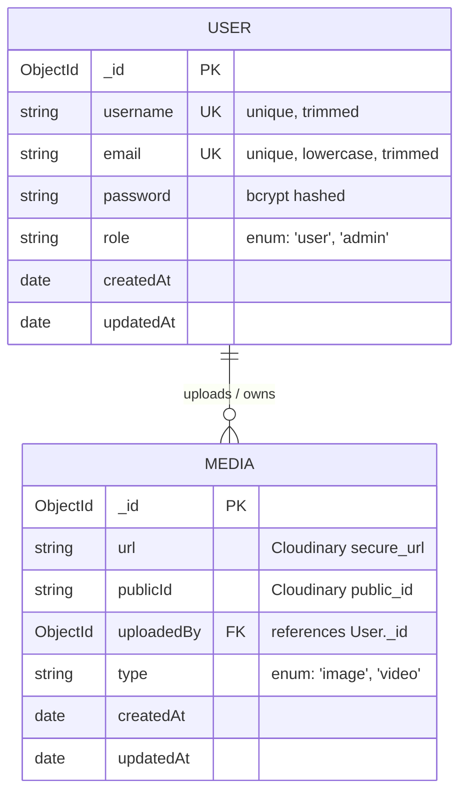
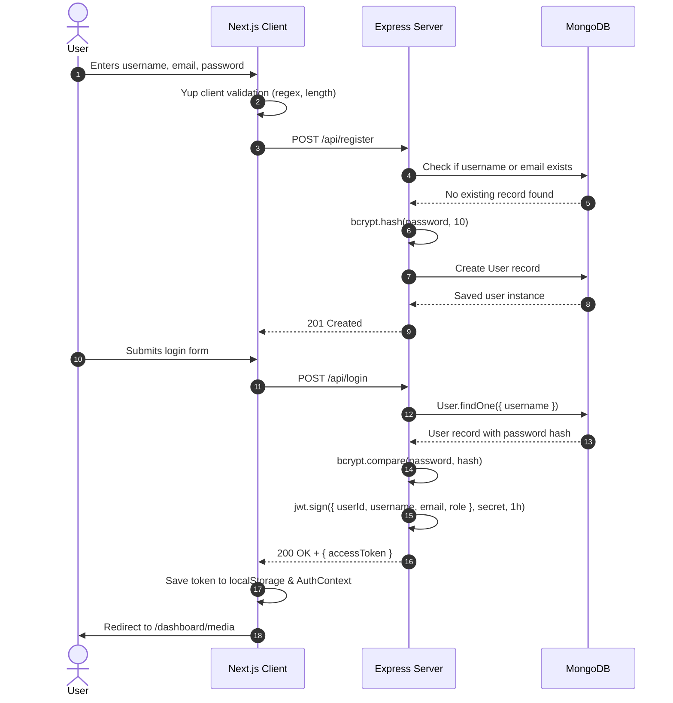
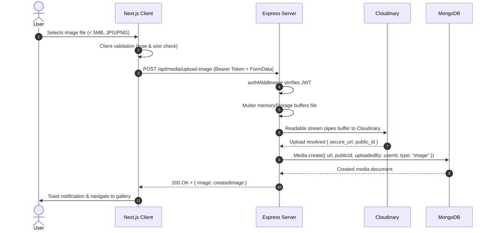
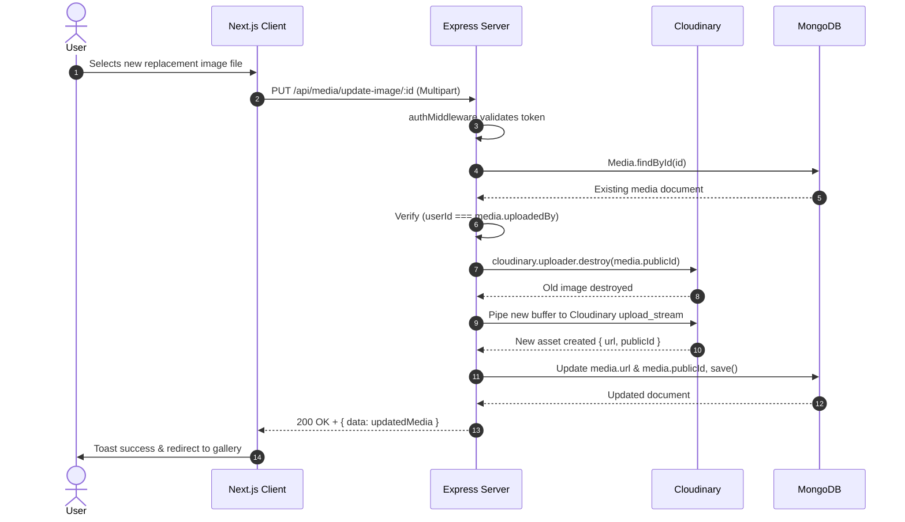
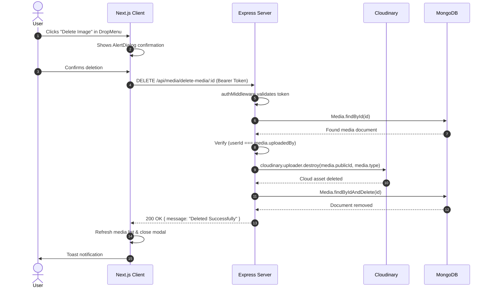
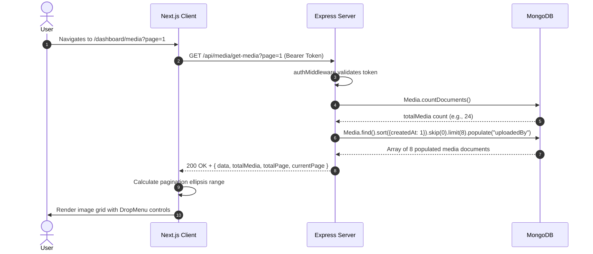

# 📸 Pixify — Full-Stack Media Sharing Platform

[](https://nextjs.org/)
[](https://react.dev/)
[](https://nodejs.org/)
[](https://expressjs.com/)
[](https://www.mongodb.com/)
[](https://cloudinary.com/)
[](https://tailwindcss.com/)
[](LICENSE)

Pixify is a modern full-stack media management and image-sharing platform built with a decoupled architecture: a **Next.js (App Router)** client and an **Express 5 REST API** backed by **MongoDB** and **Cloudinary**. Authenticated users can securely upload, browse, inspect, replace, and delete media items while enforcing strict user-ownership validation and memory-buffered stream uploads.

---

## 📑 Table of Contents

- [A. Project Overview](#a-project-overview)
  - [Problem Statement](#problem-statement)
  - [Target Users & Roles](#target-users--roles)
  - [Core Capabilities](#core-capabilities)
  - [High-Level System Overview](#high-level-system-overview)
- [B. Technology Stack](#b-technology-stack)
- [C. Key Features](#c-key-features)
- [D. Project Architecture](#d-project-architecture)
  - [Architectural Style](#architectural-style)
  - [Mermaid Architecture Diagram](#mermaid-architecture-diagram)
  - [Separation of Concerns & Data Flow](#separation-of-concerns--data-flow)
- [E. Complete Project Structure](#e-complete-project-structure)
- [F. Application & Module Documentation](#f-application--module-documentation)
  - [Backend Modules (`server/`)](#backend-modules-server)
  - [Frontend Modules (`frontend/`)](#frontend-modules-frontend)
- [G. Database Design](#g-database-design)
  - [Data Entities & Schemas](#data-entities--schemas)
  - [Mermaid Entity-Relationship (ER) Diagram](#mermaid-entity-relationship-er-diagram)
  - [Indexes, Constraints & Lifecycle Transitions](#indexes-constraints--lifecycle-transitions)
- [H. API Documentation](#h-api-documentation)
  - [Global API Conventions](#global-api-conventions)
  - [Endpoint Directory & Specifications](#endpoint-directory--specifications)
  - [Representative Request & Response Examples](#representative-request--response-examples)
- [I. Authentication & Authorization](#i-authentication--authorization)
  - [Token Lifecycle & Claims](#token-lifecycle--claims)
  - [Authorization Middleware & Ownership Guards](#authorization-middleware--ownership-guards)
- [J. Important Business Workflows](#j-important-business-workflows)
  - [1. User Registration & Authentication Flow](#1-user-registration--authentication-flow)
  - [2. Image Upload Workflow](#2-image-upload-workflow)
  - [3. In-Place Image Replacement Workflow](#3-in-place-image-replacement-workflow)
  - [4. Media Deletion Workflow](#4-media-deletion-workflow)
  - [5. Paginated Gallery Retrieval](#5-paginated-gallery-retrieval)
- [K. Environment Variables & Configuration](#k-environment-variables--configuration)
- [L. Local Development Setup](#l-local-development-setup)
  - [Prerequisites](#prerequisites)
  - [Step-by-Step Installation & Launch](#step-by-step-installation--launch)
- [M. Docker & Infrastructure](#m-docker--infrastructure)
- [N. Background Tasks, Caching & Integrations](#n-background-tasks-caching--integrations)
- [O. Testing & Code Quality](#o-testing--code-quality)
- [P. Deployment Guide](#p-deployment-guide)
- [Q. Troubleshooting](#q-troubleshooting)
- [R. Security Considerations](#r-security-considerations)
- [S. Development Workflow & Contribution Guidelines](#s-development-workflow--contribution-guidelines)
- [T. Additional Documentation & References](#t-additional-documentation--references)

---

## A. Project Overview

### Problem Statement
Hosting, sharing, and organizing personal media assets often requires complex cloud storage setups, custom CDN delivery pipelines, and reliable authorization checks to prevent unauthorized overwrites or deletions. Pixify provides a lightweight, cohesive, full-stack solution demonstrating how modern web frameworks interface with cloud-native media pipelines without disk-bound storage bottlenecks.

### Target Users & Roles
- **Guest / Unauthenticated User**: Can land on the welcome portal, learn about platform features, and access registration or sign-in views.
- **Registered User (`role: 'user'`)**: Can browse community galleries, filter their own uploaded media, view image metadata in inspection modals, upload new image files (PNG/JPG up to 5 MB), update their existing images with replacement files, and delete their own media.
- **Administrator (`role: 'admin'`)**: Supported at the data model and JWT token level for administrative extension. *(Note: Codebase currently enforces ownership checks; dedicated admin dashboard views are a planned capability).*

### Core Capabilities
- **Stateless JWT Authentication**: Secure user registration and login with bcrypt password hashing and token expiry checks.
- **Memory-Buffered Cloud Streaming**: Zero disk writes on the server — Multer buffers images in RAM, and a Node.js `Readable` stream pipes the payload directly to Cloudinary.
- **Granular Ownership Enforcement**: Backend authorization middleware verifies that media update and deletion requests originate from the asset's author.
- **Client & Server Validation**: Multi-stage validation covering credentials, MIME types, and file payload size caps (5 MB).
- **Responsive Dashboard UI**: Next.js App Router with Tailwind CSS v4, Lucide icons, Radix UI modals, and custom dynamic pagination.

### High-Level System Overview
```
[ Next.js 16 Client ] <--- HTTP/REST + JWT ---> [ Express 5 Server ]
                                                   |         |
                                         Mongoose  |         | Cloudinary SDK
                                                   v         v
                                            [ MongoDB ]   [ Cloudinary CDN ]
```

---

## B. Technology Stack

| Layer / Category | Technology | Version | Purpose & Architectural Role |
| :--- | :--- | :--- | :--- |
| **Frontend Framework** | [Next.js](https://nextjs.org/) | `^16.1.6` | App Router client application, routing, layouts, SSR/CSR hydration |
| **Frontend Library** | [React](https://react.dev/) | `^19.0.0` | UI component tree, component state, lifecycle hooks |
| **Styling & Design** | [Tailwind CSS](https://tailwindcss.com/) | `^4.0.0` | Utility-first responsive CSS styling with PostCSS plugin |
| **UI Primitives** | [Radix UI](https://www.radix-ui.com/) | Varied | Accessible primitives: `@radix-ui/react-dialog`, `alert-dialog`, `dropdown-menu`, `label`, `slot` |
| **Icons** | [Lucide React](https://lucide.dev/) | `^0.487.0` | Modern, lightweight icons for UI navigation and controls |
| **Form Management** | [React Hook Form](https://react-hook-form.com/) | `^7.56.1` | Performant form state handling with minimal re-renders |
| **Schema Validation** | [Yup](https://github.com/jquense/yup) | `^1.6.1` | Client-side schema validation for registration and login |
| **HTTP Client** | [Axios](https://axios-http.com/) | `^1.8.4` | Promise-based HTTP client for API requests and multipart uploads |
| **Client Notifications** | [React Toastify](https://fkhadra.github.io/react-toastify/) | `^11.0.5` | Feedback toast alerts for authentication and CRUD actions |
| **Token Handling (Client)** | [jwt-decode](https://github.com/auth0/jwt-decode) | `^4.0.0` | Client-side decoding of JWT claims for expiration and ownership validation |
| **Backend Runtime** | [Node.js](https://nodejs.org/) | `>=18.x` | Server-side JavaScript execution environment (CommonJS) |
| **Backend Framework** | [Express](https://expressjs.com/) | `^5.1.0` | HTTP web server, routing, middleware orchestration, REST API |
| **Database & ODM** | [Mongoose](https://mongoosejs.com/) / [MongoDB](https://www.mongodb.com/) | `^8.13.2` | Document database and object data modeling for User and Media entities |
| **Password Encryption** | [bcryptjs](https://github.com/dcodeIO/bcrypt.js) | `^3.0.2` | Salted password hashing (cost factor 10) for safe credential storage |
| **Token Authority** | [jsonwebtoken](https://github.com/auth0/node-jsonwebtoken) | `^9.0.2` | Creation and verification of signed HMAC SHA-256 JWT access tokens |
| **Multipart Uploads** | [Multer](https://github.com/expressjs/multer) | `^1.4.5-lts.2` | In-memory storage multipart form parser for image file uploads |
| **Cloud Media Service** | [Cloudinary SDK](https://cloudinary.com/documentation/node_integration) | `^2.6.0` | Cloud media asset hosting, upload streams, transformations, and asset destruction |
| **CORS Middleware** | [cors](https://github.com/expressjs/cors) | `^2.8.5` | Cross-Origin Resource Sharing control with credential support |
| **Dev Tooling (Backend)** | [Nodemon](https://nodemon.io/) | `^3.1.9` | Auto-reloading development server for Node.js |
| **Linter** | [ESLint](https://eslint.org/) | `^9.0.0` | Next.js core web vitals and JavaScript code linting |

---

## C. Key Features

### 1. Identity & Access Management (`server/Controller/AuthController.js`)
- **User Registration**: Enforces uniqueness on both `username` and `email`, hashes passwords with `bcryptjs` (salt rounds: 10), and assigns a default `role: "user"`.
- **JWT Login**: Validates credentials against stored hashes and issues a 1-hour signed JWT containing `{ userId, username, email, role }`.
- **Client Auth Context & Expiry Guard**: `frontend/src/components/authContext/index.js` listens to `localStorage`, decodes the token with `jwt-decode`, checks `exp * 1000 < Date.now()`, and purges stale sessions automatically.
- **Route Protection**: Next.js client-side redirection guards against unauthenticated visits to `/dashboard/*`, while Express `authMiddleware` protects all media endpoints.

### 2. Media Asset Lifecycle (`server/Controller/MediaController.js`)
- **Direct Stream Upload**: Uploaded files are held in memory (`multer.memoryStorage()`) and piped directly to Cloudinary using `streamUpload(buffer, "image")`, avoiding server filesystem writes.
- **Community Gallery Browsing**: `GET /api/media/get-media` supports pagination (`page`, `limit`) and sorting (`sortBy`, `sortOrder`), returning populated uploader information (`username`, `email`).
- **Personal Media Filtering**: `GET /api/media/get-media/:id` retrieves only assets uploaded by the targeted user ID.
- **In-Place Image Update**: `PUT /api/media/update-image/:id` allows an asset owner to replace an existing image. The system deletes the old asset from Cloudinary via `cloudinary.uploader.destroy(publicId)`, uploads the new image, and updates the existing document with the new `url` and `publicId`.
- **Media Asset Deletion**: `DELETE /api/media/delete-media/:id` verifies ownership, permanently destroys the asset in Cloudinary, and removes the document from MongoDB.

### 3. User Interface & Experience (`frontend/src/`)
- **Dynamic Header & Navigation**: Displays active route pills, conditional navigation items based on authentication state, and an accessible mobile slide-out drawer.
- **Image Inspector Dialog**: Interactive Radix UI dialog displaying full-resolution preview, Cloudinary `publicId`, author username, creation timestamp, and last update timestamp.
- **Ellipsis Pagination**: Smart pagination component calculating windowed page ranges with ellipsis markers (`...`) based on server total page counts.
- **Interactive Action Dropdown**: Image cards render a contextual dropdown menu (`DropMenu`) offering quick links to view details, update, or delete (with an `AlertDialog` confirmation modal). Non-owners are prevented from accessing edit or delete options.

---

## D. Project Architecture

### Architectural Style
Pixify uses a **Decoupled Client-Server Architecture** communicating over a stateless JSON/REST API over HTTP:
- **Presentation Layer (Frontend)**: Next.js client handling UI rendering, client-side routing, form validation, and token persistence in the browser.
- **Application & API Layer (Backend)**: Express 5 server providing routing, authentication middleware, file validation, business logic, and error handling.
- **Persistence & Cloud Storage Layer**: MongoDB for relational metadata storage (Users and Media) and Cloudinary for media asset hosting and global CDN delivery.

### Mermaid Architecture Diagram



### Separation of Concerns & Data Flow
1. **Frontend**: Manages local user interaction, client-side input validation with Yup, UI state, and attaches the JWT `Authorization: Bearer <token>` to outbound requests.
2. **Middleware Pipeline**: Requests pass through CORS validation, body parsers, JWT verification (`authMiddleware`), and Multer memory buffering (`uploadMiddleware`).
3. **Controllers**: Enforce business rules (e.g., duplicate user detection, file presence, uploader ownership checks).
4. **Cloudinary Helper**: Decouples third-party streaming logic from HTTP controllers, encapsulating `Readable.from(buffer).pipe(upload_stream)`.
5. **Database Models**: Handle schema structure, validations, timestamps, and relational references via Mongoose.

---

## E. Complete Project Structure

```text
Pixify/
├── .gitignore                   # Root Git ignore rules (when configured)
├── README.md                    # Project-level architecture and documentation
├── frontend/                    # Next.js 16 App Router client application
│   ├── .env                     # Frontend environment variables (NEXT_PUBLIC_BACK_END)
│   ├── .gitignore               # Frontend Git ignore exclusions
│   ├── components.json          # shadcn/ui configuration manifest
│   ├── eslint.config.mjs        # ESLint flat configuration extending next/core-web-vitals
│   ├── jsconfig.json            # Path alias configuration mapping '@/...' to './src/...'
│   ├── next.config.js           # Next.js config (Cloudinary/Unsplash remote image patterns)
│   ├── package.json             # Frontend dependency manifest and scripts
│   ├── postcss.config.mjs       # Tailwind CSS PostCSS plugin integration
│   ├── public/                  # Static assets served by Next.js
│   │   ├── favicon.png          # Browser favicon
│   │   └── heroImage.png        # Landing page illustration
│   └── src/
│       ├── app/
│       │   ├── auth/
│       │   │   ├── sign-in/     # Login page with React Hook Form + Yup
│       │   │   └── sign-up/     # Registration page with schema validation
│       │   ├── dashboard/
│       │   │   ├── edit/
│       │   │   │   └── [...id]/ # In-place image replacement page
│       │   │   ├── media/       # Community gallery page with pagination
│       │   │   │   ├── [...id]/ # User-filtered gallery page
│       │   │   │   ├── Media.jsx# Gallery grid, pagination range calculation
│       │   │   │   └── page.js  # Media page route with Suspense fallback
│       │   │   └── upload/      # File upload form with client MIME/size checks
│       │   ├── globals.css      # Tailwind CSS directives and custom styling
│       │   ├── layout.js        # Root HTML layout with AuthProvider & ToastContainer
│       │   └── page.js          # Landing page hero view
│       ├── components/
│       │   ├── Loader/          # Reusable SVG animated loading spinner
│       │   ├── authContext/     # React Context for JWT lifecycle, login, logout
│       │   ├── commonLayout/    # Application wrapper rendering Header and main content
│       │   ├── dropMenu/        # Contextual card actions (View, Edit, Delete modals)
│       │   ├── header/          # Responsive navigation bar with mobile drawer
│       │   └── ui/              # Radix UI + Tailwind reusable components
│       │       ├── alert-dialog.jsx
│       │       ├── button.jsx
│       │       ├── dialog.jsx
│       │       ├── dropdown-menu.jsx
│       │       ├── input.jsx
│       │       ├── label.jsx
│       │       ├── pagination.jsx
│       │       └── textarea.jsx
│       └── lib/
│           └── utils.js         # cn() utility combining clsx and tailwind-merge
└── server/                      # Express 5 REST API backend application
    ├── .env                     # Server environment secrets and config
    ├── .gitIgnore               # Server-specific Git ignore rules
    ├── Controller/
    │   ├── AuthController.js    # Register and login controllers
    │   └── MediaController.js   # Upload, fetch, user fetch, update, delete controllers
    ├── Database/
    │   └── index.js             # Mongoose connection bootstrapper
    ├── MiddleWare/
    │   ├── authMiddleware.js    # Bearer token verification and req.userInfo assignment
    │   └── uploadMiddleware.js  # Multer memory storage and MIME type filtering
    ├── Model/
    │   ├── Media.js             # Media schema and model definition
    │   └── User.js              # User schema and model definition
    ├── Routes/
    │   ├── authRoute.js         # /api routes (login, register)
    │   └── mediaRoute.js        # /api/media routes (upload, fetch, update, delete)
    ├── cloudinaryHelpers/
    │   └── index.js             # streamUpload helper piping buffer to Cloudinary
    ├── config/
    │   └── cloudinary.js        # Cloudinary SDK v2 configuration
    ├── package.json             # Server dependency manifest and scripts
    └── server.js                # Express entry point, middleware wiring, listener
```

---

## F. Application & Module Documentation

### Backend Modules (`server/`)

#### 1. Entry Point (`server/server.js`)
- Loads environment variables using `dotenv.config()`.
- Initializes database connection via `connectToDB()`.
- Mounts `cors()` middleware with origin locked to `process.env.FRONTEND_URL` and `credentials: true`.
- Parses incoming JSON payloads with `express.json()`.
- Registers route trees: `/api` for auth routes and `/api/media` for media routes.
- Binds listener to `process.env.PORT`.

#### 2. Database Connection (`server/Database/index.js`)
- Exports `connectToDB`, an async function calling `mongoose.connect(process.env.CONNECTION_STRING)`. Logs connection status to stdout.

#### 3. Middleware
- **`MiddleWare/authMiddleware.js`**: Inspects `req.headers["authorization"]` for `Bearer <token>`. Decodes the token using `jwt.verify(token, process.env.JWT_SECRET_KEY)`. Populates `req.userInfo = { userId: decodedToken.userId, role: decodedToken.role }`. If missing or invalid, halts execution with `401 Unauthorized`.
- **`MiddleWare/uploadMiddleware.js`**: Configures Multer with `multer.memoryStorage()`, ensuring no temporary files touch the server disk. Enforces a 5 MB file size limit (`5 * 1024 * 1024`) and verifies `file.mimetype.startsWith("image")`.

#### 4. Cloudinary Stream Helper (`server/cloudinaryHelpers/index.js`)
- Exports `streamUpload(buffer, type = "image")`.
- Converts raw memory buffers into readable streams via `Readable.from(buffer)` and pipes them to `cloudinary.uploader.upload_stream`.
- Resolves with an object containing `{ url: result.secure_url, publicId: result.public_id }`.

#### 5. Controllers
- **`Controller/AuthController.js`**:
  - `register`: Checks required fields (`username`, `email`, `password`). Queries for existing users (`$or: [{ username }, { email }]`), hashes passwords with bcrypt (10 rounds), and writes new user to database. Returns HTTP 201.
  - `login`: Validates credentials, compares password hashes with `bcrypt.compare`, and returns a signed JWT containing user claims with a 1-hour expiration.
- **`Controller/MediaController.js`**:
  - `UploadImageController`: Receives buffered file from Multer, pipes to Cloudinary, and persists new `Media` document with `uploadedBy` bound to `req.userInfo.userId`.
  - `fetchController`: Retrieves paginated community media sorted by `createdAt` (or custom parameter) and populates the `uploadedBy` reference with `username` and `email`.
  - `fetchUserMediaController`: Queries media filtered by `uploadedBy: req.params.id`.
  - `UpdateImageController`: Verifies asset existence and author ownership (`req.userInfo.userId === media.uploadedBy.toString()`). Destroys the old Cloudinary asset using `media.publicId`, streams the new image, and updates the existing document.
  - `deleteMediaController`: Validates author ownership, destroys Cloudinary asset, and deletes the MongoDB document via `Media.findByIdAndDelete`.

---

### Frontend Modules (`frontend/`)

#### 1. Auth Context (`frontend/src/components/authContext/index.js`)
- Maintains `token`, `userId`, `loading`, and provides `login(token)` and `logout()` methods.
- Automatically checks token expiration on mount (`decoded.exp * 1000 < Date.now()`). Purges expired tokens and resets state.

#### 2. Navigation Header (`frontend/src/components/header/index.js`)
- Renders responsive desktop and mobile navigation links.
- Uses conditional rendering based on authentication state (displays Home, Login, Register when logged out; displays Home, Media, Upload Image, Uploaded Image, and Logout when logged in).
- Includes an `AlertDialog` for logout confirmation.

#### 3. Media Gallery (`frontend/src/app/dashboard/media/Media.jsx`)
- Fetches paginated media from `/api/media/get-media?page=N`.
- Renders responsive grid (`sm:grid-cols-2 md:grid-cols-3 lg:grid-cols-4`).
- Computes windowed pagination ranges with ellipsis markers.
- Renders `DropMenu` on each card for details, updates, and deletions.

#### 4. Action Dropdown Menu (`frontend/src/components/dropMenu/index.js`)
- Contextual menu attached to each media card.
- Automatically checks client token against `uploadedBy._id` to determine whether the user is authorized to edit or delete the asset.
- **View Modal**: Displays high-resolution image, author username, Cloudinary `publicId`, and timestamps.
- **Delete Action**: Triggers an `AlertDialog` modal before invoking `DELETE /api/media/delete-media/:id`.

---

## G. Database Design

### Data Entities & Schemas

The database layer is managed using **Mongoose** connected to MongoDB.

#### 1. `User` Schema (`server/Model/User.js`)
| Field | Type | Required | Constraints | Description |
| :--- | :--- | :--- | :--- | :--- |
| `_id` | `ObjectId` | Auto | Primary Key | MongoDB unique document identifier |
| `username` | `String` | Yes | `unique: true`, `trim: true` | Unique username chosen during registration |
| `email` | `String` | Yes | `unique: true`, `lowercase: true`, `trim: true` | Unique user email address |
| `password` | `String` | Yes | `trim: true` | Bcrypt password hash |
| `role` | `String` | No | `enum: ['user', 'admin']`, `default: 'user'` | Access control role |
| `createdAt` | `Date` | Auto | Managed by Mongoose | Timestamp of user creation |
| `updatedAt` | `Date` | Auto | Managed by Mongoose | Timestamp of last user update |

#### 2. `Media` Schema (`server/Model/Media.js`)
| Field | Type | Required | Constraints | Description |
| :--- | :--- | :--- | :--- | :--- |
| `_id` | `ObjectId` | Auto | Primary Key | MongoDB unique document identifier |
| `url` | `String` | Yes | Valid URL | Cloudinary secure delivery URL (`secure_url`) |
| `publicId` | `String` | Yes | String identifier | Cloudinary asset identifier used for deletion |
| `uploadedBy` | `ObjectId` | Yes | `ref: 'User'` | Foreign reference pointing to the author `User._id` |
| `type` | `String` | Yes | `enum: ['image', 'video']` | Asset type (*active implementation accepts 'image'*) |
| `createdAt` | `Date` | Auto | Managed by Mongoose | Timestamp of media upload |
| `updatedAt` | `Date` | Auto | Managed by Mongoose | Timestamp of last media update |

### Mermaid Entity-Relationship (ER) Diagram



### Indexes, Constraints & Lifecycle Transitions
- **Unique Indexes**: MongoDB maintains unique indexes on `User.username` and `User.email`.
- **Relational Integrity**: `Media.uploadedBy` references the `User` collection. When fetching media, the backend executes `.populate("uploadedBy", "username email")` to hydrate author identity.
- **Media Lifecycle**:
  1. *Upload*: Image buffer uploaded to Cloudinary $\rightarrow$ metadata stored in MongoDB with `uploadedBy = req.userInfo.userId`.
  2. *Update*: Existing document retrieved $\rightarrow$ ownership confirmed $\rightarrow$ old Cloudinary asset destroyed $\rightarrow$ new asset uploaded $\rightarrow$ document fields updated and saved.
  3. *Delete*: Document retrieved $\rightarrow$ ownership confirmed $\rightarrow$ Cloudinary asset destroyed $\rightarrow$ MongoDB document removed.

---

## H. API Documentation

### Global API Conventions
- **Base URL**: `http://localhost:5000` (or `PORT` configured in environment)
- **Content Types**: 
  - Standard endpoints: `application/json`
  - Upload endpoints: `multipart/form-data`
- **Authentication Header**: `Authorization: Bearer <JWT_TOKEN>`
- **Response Format**: JSON containing `success: Boolean`, `message: String`, and optional payload keys (`data`, `image`, `accessToken`).

### Endpoint Directory & Specifications

| Method | Endpoint | Purpose | Auth Required | Role / Ownership | Request Body / Query Params | Status Codes |
| :--- | :--- | :--- | :--- | :--- | :--- | :--- |
| **POST** | `/api/register` | Register new user account | No | Public | JSON: `{ username, email, password, role? }` | `201`, `400`, `409`, `500` |
| **POST** | `/api/login` | Authenticate & obtain JWT | No | Public | JSON: `{ username, password }` | `200`, `400`, `401`, `500` |
| **POST** | `/api/media/upload-image` | Upload an image asset | Yes | Authenticated User | Multipart form: `image` (File, max 5MB) | `200`, `400`, `401`, `500` |
| **GET** | `/api/media/get-media` | Get paginated community media | Yes | Authenticated User | Query: `page` (int), `limit` (int), `sortBy`, `sortOrder` | `200`, `401`, `500` |
| **GET** | `/api/media/get-media/:id` | Get media by specific user | Yes | Authenticated User | Param: `id` (userId); Query: `page`, `limit`, `sortBy`, `sortOrder` | `200`, `401`, `404`, `500` |
| **PUT** | `/api/media/update-image/:id`| Replace existing image asset | Yes | Asset Author Only | Param: `id` (mediaId); Multipart: `image` (File) | `200`, `400`, `401`, `404`, `500` |
| **DELETE**| `/api/media/delete-media/:id`| Delete media asset & cloud file | Yes | Asset Author Only | Param: `id` (mediaId) | `200`, `401`, `404`, `500` |

---

### Representative Request & Response Examples

#### 1. User Registration (`POST /api/register`)
```bash
curl -X POST http://localhost:5000/api/register \
  -H "Content-Type: application/json" \
  -d '{
    "username": "johndoe",
    "email": "johndoe@example.com",
    "password": "SecurePassword123!"
  }'
```
**Response (`201 Created`):**
```json
{
  "success": true,
  "message": "User registered successfully",
  "data": {
    "_id": "673f1a2b8e1a2c3d4e5f6a7b",
    "username": "johndoe",
    "email": "johndoe@example.com",
    "role": "user",
    "createdAt": "2026-10-21T12:00:00.000Z",
    "updatedAt": "2026-10-21T12:00:00.000Z"
  }
}
```

#### 2. User Login (`POST /api/login`)
```bash
curl -X POST http://localhost:5000/api/login \
  -H "Content-Type: application/json" \
  -d '{
    "username": "johndoe",
    "password": "SecurePassword123!"
  }'
```
**Response (`200 OK`):**
```json
{
  "success": true,
  "message": "Login successful",
  "accessToken": "eyJhbGciOiJIUzI1NiIsInR5cCI6IkpXVCJ9..."
}
```

#### 3. Image Upload (`POST /api/media/upload-image`)
```bash
curl -X POST http://localhost:5000/api/media/upload-image \
  -H "Authorization: Bearer <TOKEN>" \
  -F "image=@/path/to/landscape.jpg"
```
**Response (`200 OK`):**
```json
{
  "success": true,
  "message": "Image uploaded Successfully",
  "image": {
    "_id": "673f2b4c8e1a2c3d4e5f8899",
    "url": "https://res.cloudinary.com/cloudname/image/upload/v1729500000/sample.jpg",
    "publicId": "sample_public_id",
    "uploadedBy": "673f1a2b8e1a2c3d4e5f6a7b",
    "type": "image",
    "createdAt": "2026-10-21T12:05:00.000Z",
    "updatedAt": "2026-10-21T12:05:00.000Z"
  }
}
```

#### 4. Fetch Paginated Media (`GET /api/media/get-media?page=1&limit=8`)
```bash
curl -X GET "http://localhost:5000/api/media/get-media?page=1&limit=8" \
  -H "Authorization: Bearer <TOKEN>"
```
**Response (`200 OK`):**
```json
{
  "success": true,
  "message": "Image Fetched Successfully",
  "data": [
    {
      "_id": "673f2b4c8e1a2c3d4e5f8899",
      "url": "https://res.cloudinary.com/cloudname/image/upload/v1729500000/sample.jpg",
      "publicId": "sample_public_id",
      "type": "image",
      "uploadedBy": {
        "_id": "673f1a2b8e1a2c3d4e5f6a7b",
        "username": "johndoe",
        "email": "johndoe@example.com"
      },
      "createdAt": "2026-10-21T12:05:00.000Z",
      "updatedAt": "2026-10-21T12:05:00.000Z"
    }
  ],
  "currentPage": 1,
  "TotalMedia": 1,
  "TotalPage": 1,
  "pageLimit": 8
}
```

#### 5. Delete Media (`DELETE /api/media/delete-media/:id`)
```bash
curl -X DELETE http://localhost:5000/api/media/delete-media/673f2b4c8e1a2c3d4e5f8899 \
  -H "Authorization: Bearer <TOKEN>"
```
**Response (`200 OK`):**
```json
{
  "success": true,
  "message": "The Media has been deleted Successfully."
}
```

---

## I. Authentication & Authorization

### Token Lifecycle & Claims
1. **Creation**: On valid login, `AuthController.js` calls `jwt.sign(...)` using HMAC SHA-256 and `process.env.JWT_SECRET_KEY`.
2. **Payload Claims**:
   ```json
   {
     "userId": "673f1a2b8e1a2c3d4e5f6a7b",
     "username": "johndoe",
     "email": "johndoe@example.com",
     "role": "user",
     "iat": 1729510000,
     "exp": 1729513600
   }
   ```
3. **Storage & Transmission**: The client stores the token in `localStorage` under key `"token"`. Outbound Axios and fetch calls include `Authorization: Bearer <token>`.
4. **Client-Side Invalidation**: `AuthProvider` inspects `decoded.exp * 1000 < Date.now()` on page load. Expired tokens are immediately cleared from `localStorage`.

### Authorization Middleware & Ownership Guards
- **`authMiddleware`**: Verifies the signature and expiration of incoming tokens. Sets `req.userInfo = { userId, role }`. If verification fails, returns:
  ```json
  { "success": false, "message": "Invalid or expired token" }
  ```
- **Ownership Validation**:
  - `UpdateImageController`: `userId !== media.uploadedBy.toString()` $\rightarrow$ Returns `401 Unauthorized`.
  - `deleteMediaController`: `userId != media.uploadedBy.toString()` $\rightarrow$ Returns `401 Unauthorized`.
  - Frontend `DropMenu`: Computes `validUser = (jwtDecode(token).userId === uploadedBy._id)`. Disables the Update and Delete actions in the UI when the viewer does not own the asset.

---

## J. Important Business Workflows

### 1. User Registration & Authentication Flow



---

### 2. Image Upload Workflow



---

### 3. In-Place Image Replacement Workflow



---

### 4. Media Deletion Workflow



---

### 5. Paginated Gallery Retrieval



---

## K. Environment Variables & Configuration

Pixify requires environment configuration files in both the backend (`server/.env`) and frontend (`frontend/.env`).

> [!WARNING]
> Never commit actual credentials, database passwords, or JWT secrets to version control. Ensure both `.env` files are listed in their respective `.gitignore` files.

### Backend Environment Configuration (`server/.env`)

| Variable Name | Required | Type | Example / Safe Placeholder | Purpose & Usage |
| :--- | :--- | :--- | :--- | :--- |
| `PORT` | Yes | Integer | `5000` | Port on which the Express HTTP server listens |
| `CONNECTION_STRING` | Yes | String (URI) | `mongodb+srv://<user>:<password>@cluster0.mongodb.net/pixify` | MongoDB Atlas or local connection string |
| `JWT_SECRET_KEY` | Yes | String | `your_super_secret_jwt_key_min_32_characters` | Secret key used for signing and verifying HMAC SHA-256 JWTs |
| `CLOUD_NAME` | Yes | String | `your_cloudinary_cloud_name` | Cloudinary account cloud identifier |
| `API_KEY` | Yes | String | `123456789012345` | Cloudinary API access key |
| `API_SECRET` | Yes | String | `your_cloudinary_api_secret` | Cloudinary API access secret |
| `FRONTEND_URL` | Yes | String (URL) | `http://localhost:3000` | Allowed origin for Cross-Origin Resource Sharing (CORS) |

### Frontend Environment Configuration (`frontend/.env` or `frontend/.env.local`)

| Variable Name | Required | Type | Example / Safe Placeholder | Purpose & Usage |
| :--- | :--- | :--- | :--- | :--- |
| `NEXT_PUBLIC_BACK_END` | Yes | String (URL) | `http://localhost:5000` | Public backend base URL used by browser-side Axios and fetch requests |

---

## L. Local Development Setup

Follow these verified step-by-step instructions to clone, install, configure, and run Pixify on your local development machine.

### Prerequisites
- **Node.js**: `v18.17.0` or higher (`node -v`)
- **npm**: `v9.x` or higher (`npm -v`)
- **MongoDB**: A running local MongoDB instance (`mongodb://localhost:27017/pixify`) or a free [MongoDB Atlas](https://www.mongodb.com/cloud/atlas) cluster
- **Cloudinary Account**: Free tier account providing `CLOUD_NAME`, `API_KEY`, and `API_SECRET` from the [Cloudinary Console](https://cloudinary.com/)

---

### Step-by-Step Installation & Launch

#### 1. Clone the Repository
```bash
git clone https://github.com/Nirajan09/image-sharing-platform.git
cd image-sharing-platform
```

#### 2. Configure Backend Environment
Navigate into the `server` directory and create `.env`:
```bash
cd server
```
Create a file named `.env` with the following content:
```env
PORT=5000
CONNECTION_STRING=mongodb://localhost:27017/pixify
JWT_SECRET_KEY=replace_with_a_secure_random_jwt_secret_key_123456
CLOUD_NAME=your_cloudinary_cloud_name
API_KEY=your_cloudinary_api_key
API_SECRET=your_cloudinary_api_secret
FRONTEND_URL=http://localhost:3000
```

#### 3. Install Backend Dependencies
```bash
npm install
```

#### 4. Configure Frontend Environment
In a separate terminal tab or window, navigate into `frontend`:
```bash
cd ../frontend
```
Create a file named `.env` with the following content:
```env
NEXT_PUBLIC_BACK_END=http://localhost:5000
```

#### 5. Install Frontend Dependencies
```bash
npm install
```

#### 6. Start the Development Servers

**Start the Backend API Server:**
```bash
# In the server/ directory
npm run dev
```
*Output should indicate:*
```text
[nodemon] starting `node server.js`
Database Connection is Successful
Server is running on the port 5000
```

**Start the Next.js Frontend Client:**
```bash
# In the frontend/ directory
npm run dev
```
*Output should indicate:*
```text
  ▲ Next.js 16.1.6
  - Local:        http://localhost:3000
```

#### 7. Verify Application Health
1. Open your browser and navigate to `http://localhost:3000`.
2. Click **Get Started** or **Register** to create a test user.
3. Sign in to access `/dashboard/media`.
4. Navigate to **Upload Image** (`/dashboard/upload`), choose a `.jpg` or `.png` file (< 5 MB), and submit.
5. Verify the uploaded image renders in the community gallery.

---

## M. Docker & Infrastructure

### Current Repository State
> [!NOTE]
> **No Docker or container orchestration files are currently checked into the repository.**
> There are no `Dockerfile`, `docker-compose.yml`, or Kubernetes manifests in either `frontend/` or `server/`.

### Development vs. Production Infrastructure Architecture
- **Development**: Two standalone processes running concurrently:
  - Backend: Node.js process managed via `nodemon` on port `5000`.
  - Frontend: Next.js dev server running on port `3000`.
- **Target Production Infrastructure**:
  - Frontend: Deployed to a Node.js server or serverless edge platform (e.g., Vercel, AWS Amplify, Docker container running `next start`).
  - Backend: Containerized or hosted on a PaaS (e.g., Render, Railway, AWS ECS) with environment variables injected securely.
  - Database: Managed MongoDB Atlas cluster.
  - Storage & CDN: Cloudinary global edge CDN.

---

## N. Background Tasks, Caching & Integrations

### Integrations Present in Codebase

#### 1. Cloudinary SDK (`cloudinary` v2)
- **Role**: Cloud object storage, asset hosting, and CDN distribution.
- **Configuration**: `server/config/cloudinary.js` initializes `cloudinary.config()` with credentials from `process.env`.
- **Upload Flow**: `server/cloudinaryHelpers/index.js` wraps `cloudinary.uploader.upload_stream` in a Promise, piping a Node.js `Readable` stream buffer.
- **Asset Destruction**: `cloudinary.uploader.destroy(publicId)` is called during media replacement (`UpdateImageController`) and media deletion (`deleteMediaController`).

#### 2. In-Memory Buffering (Multer)
- **Role**: Upload stream buffering.
- **Behavior**: Uses `multer.memoryStorage()`, keeping file bytes in RAM buffers (`req.file.buffer`) to stream directly to Cloudinary without creating temporary disk files.

#### 3. Caching & Background Queues
- **Caching**: No external cache layer (such as Redis or Memcached) is implemented. Next.js API calls to media endpoints explicitly specify `cache: "no-store"` to ensure up-to-date gallery state.
- **Task Queues**: No background workers or task schedulers (such as BullMQ, Celery, or RabbitMQ) are configured. All upload and destroy operations are handled asynchronously inline within HTTP request lifecycles.

---

## O. Testing & Code Quality

### Testing
- **Backend Test Suite**: No automated unit or integration tests are currently configured. Running `npm test` in `server/` outputs:
  ```text
  Error: no test specified
  ```
- **Frontend Test Suite**: No Jest, Vitest, or Cypress test configurations exist in `frontend/`.

### Code Quality & Linting
- **ESLint**: Configured in `frontend/eslint.config.mjs` extending `next/core-web-vitals`.
- **Running Frontend Linter**:
  ```bash
  cd frontend
  npm run lint
  ```
- **Recommended Test Suite Additions**:
  - Backend: Supertest + Jest/Mocha for testing authentication endpoints (`/api/register`, `/api/login`) and media CRUD permissions.
  - Frontend: React Testing Library + Vitest for testing form schemas, context providers, and protected route redirection.

---

## P. Deployment Guide

### Production Build & Deployment Considerations

#### 1. Backend (`server/`)
1. **Environment Setup**: Ensure all required environment variables (`PORT`, `CONNECTION_STRING`, `JWT_SECRET_KEY`, `CLOUD_NAME`, `API_KEY`, `API_SECRET`, `FRONTEND_URL`) are populated in your hosting provider's dashboard.
2. **CORS Configuration**: Set `FRONTEND_URL` to your production frontend domain (e.g., `https://pixify.example.com`).
3. **Execution**: Use a process manager like PM2 or Docker:
   ```bash
   cd server
   npm install --omit=dev
   npm start
   ```

#### 2. Frontend (`frontend/`)
1. **Environment Setup**: Set `NEXT_PUBLIC_BACK_END` to your production backend URL (e.g., `https://api.pixify.example.com`).
2. **Production Bundle Compilation**:
   ```bash
   cd frontend
   npm install
   npm run build
   ```
3. **Production Server Launch**:
   ```bash
   npm start
   ```
4. **Remote Image Whitelisting**: Verify `next.config.js` includes any external domains serving image assets (`res.cloudinary.com` is configured by default).

---

## Q. Troubleshooting

| Symptom / Error | Root Cause | Diagnostic Step | Resolution |
| :--- | :--- | :--- | :--- |
| `Database Connection Failed` | MongoDB is unreachable or `CONNECTION_STRING` is invalid | Inspect MongoDB logs or connection string format in `server/.env` | Verify MongoDB server is running locally or check IP whitelist in MongoDB Atlas Network Access |
| `CORS Error` / Blocked Request in Browser | Frontend origin does not match `FRONTEND_URL` in `server/.env` | Check browser developer console for CORS headers | Ensure `server/.env` has `FRONTEND_URL=http://localhost:3000` (or exact matching protocol, host, port) |
| `Invalid or expired token` (`401`) | JWT expired (1-hour lifespan) or secret key mismatch | Inspect client `localStorage.getItem("token")` and verify `JWT_SECRET_KEY` in `server/.env` | Log in again to obtain a fresh token. Ensure `JWT_SECRET_KEY` remains identical between restarts |
| `Please Upload only Image` / `File too large` | Non-image file selected or file size exceeds 5 MB | Check file extension and byte size | Upload only `.jpg`, `.jpeg`, or `.png` files under 5 MB |
| `Upload Error` / `Must supply api_key` | Cloudinary environment variables are missing or incorrect | Check `server/.env` for `CLOUD_NAME`, `API_KEY`, and `API_SECRET` | Verify Cloudinary credentials in the Cloudinary Console dashboard |
| Broken / Missing Images in UI | Next.js Image component hostname mismatch | Check browser console for `Invalid src prop hostname res.cloudinary.com` | Ensure `next.config.js` has `res.cloudinary.com` declared under `images.remotePatterns` |

---

## R. Security Considerations

### Implemented Protections
- **Password Security**: Passwords are never stored in plaintext; they are hashed with `bcryptjs` using a salt work factor of 10.
- **Stateless Authorization**: Protected routes enforce JWT verification via `authMiddleware` before reaching business logic.
- **Strict Ownership Checks**: The backend verifies `req.userInfo.userId === media.uploadedBy.toString()` prior to allowing asset updates or deletions, preventing Insecure Direct Object Reference (IDOR) attacks.
- **In-Memory Streaming**: File uploads are buffered in RAM and never written to temporary files on disk, avoiding unvalidated file storage risks on the host filesystem.
- **MIME & Size Enforcement**: File types are validated both client-side and server-side against `image/*` MIME prefixes with an upper threshold of 5 MB.
- **CORS Locking**: Cross-Origin requests are restricted to the origin configured in `process.env.FRONTEND_URL`.

### Operational Recommendations
- **Rotate Secrets**: Regularly rotate `JWT_SECRET_KEY` and Cloudinary API credentials.
- **HttpOnly Cookies**: Migrating the JWT storage from `localStorage` to `HttpOnly`, `SameSite=Strict` cookies will mitigate Cross-Site Scripting (XSS) token extraction risks.
- **Rate Limiting**: Introduce `express-rate-limit` on `/api/login` and `/api/register` to prevent brute-force credential stuffing.
- **Hide Password Hashes in Output**: In `AuthController.register`, exclude the password hash field before returning `newUser` in the HTTP response body.

---

## S. Development Workflow & Contribution Guidelines

### Adding a New Backend Feature
1. **Model Definition**: If adding an entity, create a Mongoose schema in `server/Model/YourModel.js`.
2. **Controller Logic**: Implement CRUD and business validation in `server/Controller/YourController.js`.
3. **Route Mounting**: Expose endpoints in `server/Routes/yourRoute.js` and apply `authMiddleware` as needed. Mount the router in `server/server.js`.
4. **Environment Variables**: Document any new variables in both `server/.env` and this README.

### Adding a New Frontend View
1. **Page Creation**: Add a new folder in `frontend/src/app/` (e.g., `frontend/src/app/gallery/page.js`).
2. **Component Architecture**: Build reusable presentation components in `frontend/src/components/`.
3. **Auth Guards**: Use the `useAuth()` hook to check session status and redirect unauthorized users.
4. **Form Handling**: Use `react-hook-form` with `yup` schema validation for user input forms.

### Branch & Contribution Conventions
- **Feature Branches**: Use descriptive branch names: `feature/media-tags`, `fix/upload-validation`, `docs/api-guide`.
- **Commits**: Follow conventional commits: `feat:`, `fix:`, `docs:`, `refactor:`, `chore:`.
- **Pull Requests**: Provide a clear description of changes, link related issues, and verify that both frontend and backend start cleanly without errors.

---

## T. Additional Documentation & References

- [Next.js Documentation](https://nextjs.org/docs)
- [Express.js 5 Guide](https://expressjs.com/)
- [Mongoose Documentation](https://mongoosejs.com/docs/)
- [Cloudinary Node.js SDK](https://cloudinary.com/documentation/node_integration)
- [Radix UI Primitives](https://www.radix-ui.com/primitives)
- [Tailwind CSS v4 Documentation](https://tailwindcss.com/docs)
- [JSON Web Token (JWT) Standards](https://jwt.io/introduction)

---

### Author & Repository Information
- **Author**: Nirajan Tiwari
- **Email**: nirajantiwari09@gmail.com
- **Project Repository**: [https://github.com/Nirajan09/image-sharing-platform](https://github.com/Nirajan09/image-sharing-platform)
